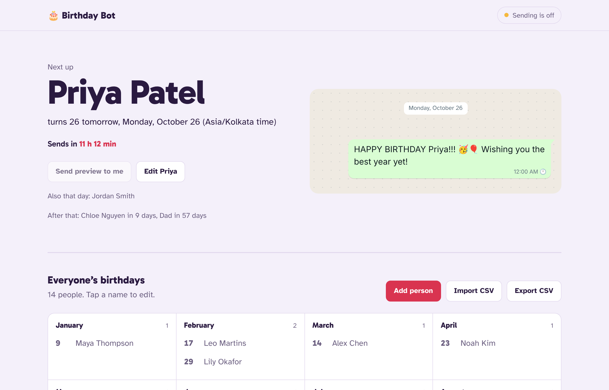
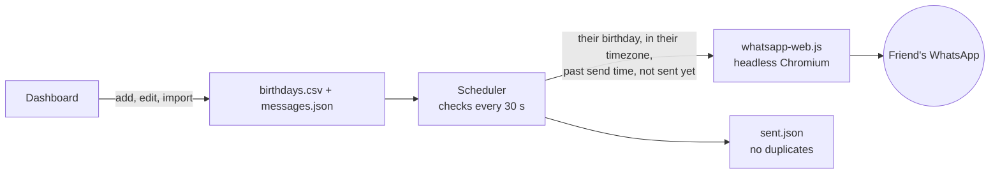

# 🎂 WhatsApp Birthday Bot

Never forget a birthday again. A small self-hosted bot that sends your friends a personalised happy-birthday message on WhatsApp, from your own number, at midnight in **their** timezone.

Add people once (or import a spreadsheet). The bot takes care of the rest, every year.



## Features

- **Sends at 12:00 AM in each person's timezone.** Friends abroad get it at their midnight, not yours. The send time is configurable.
- **Personalised messages.** `{first}`, `{name}`, `{age}`, `{ordinal}` ("Happy 24th birthday Chloe!"), plus any column you add to the CSV (`{nickname}`, `{city}`, …).
- **Your own message templates**, rotated per person, or a custom message for someone special.
- **Web dashboard.** Link WhatsApp by scanning a QR code, add and edit people, import or export CSV, see the exact message each person will get, and send a preview to yourself.
- **Reliable.** Never double-sends. If the server was down at midnight it catches up later that day. Failed sends retry with back-off.
- **Handles the edge cases**: Feb 29 birthdays, daylight saving, CSVs from Excel and Google Sheets.
- **One Docker container.** Your contacts stay on your server.

## How it works



The bot logs in to WhatsApp as a **linked device**, the same way WhatsApp Web does. Your phone does not need to stay on.

## Quick start (Docker)

```bash
git clone https://github.com/japneet250/whatsapp-birthday-bot.git
cd whatsapp-birthday-bot
cp .env.example .env        # set DASHBOARD_PASSWORD and TIMEZONE
docker compose up -d
```

1. Open <http://localhost:3000> and sign in with any username and your `DASHBOARD_PASSWORD`.
2. On your phone: WhatsApp → Settings → Linked devices → Link a device, and scan the QR code on the dashboard.
3. Add people, or import a CSV (see [`examples/birthdays.csv`](examples/birthdays.csv)).

That's it. Messages go out on their own from now on.

Once the image is published to GitHub Container Registry (the included workflow does this on every push to `main`), anyone can run it without cloning:

```bash
docker run -d --name birthday-bot --restart unless-stopped \
  -p 3000:3000 \
  -e DASHBOARD_PASSWORD=change-me \
  -e TIMEZONE=America/Toronto \
  -v birthday-bot-data:/data \
  ghcr.io/japneet250/whatsapp-birthday-bot:latest
```

## Running it 24/7

The bot has to be awake at midnight, so run it somewhere that is always on. It needs a **persistent disk mounted at `/data`** (that's where the WhatsApp login and your list live) and about **1 GB of RAM** (Chromium).

**Free:** [host it on Oracle Cloud's Always Free tier](docs/free-hosting.md) with a step-by-step guide and a one-command installer that also sets up HTTPS:

```bash
curl -fsSL https://raw.githubusercontent.com/japneet250/whatsapp-birthday-bot/main/deploy/setup-vps.sh | TIMEZONE=America/Toronto bash
```

| Where | How |
|---|---|
| Any Ubuntu/Debian server (Oracle Cloud, Google Cloud, Hetzner, DigitalOcean, a Raspberry Pi) | Run the installer above. It sets up Docker, HTTPS and a password for you. The image works on amd64 and arm64. |
| [Railway](https://railway.com) | New project → Deploy from GitHub repo (it finds the Dockerfile). Add a volume mounted at `/data`, set `DASHBOARD_PASSWORD` and `TIMEZONE`, then generate a public domain. |
| [Fly.io](https://fly.io) | See [`deploy/fly.toml`](deploy/fly.toml) for the commands. |

Hosting prices and free tiers change often, so check what's current.

**Keep the dashboard private.** Anyone who gets in can message people as you. Use a long password and only expose the dashboard over HTTPS. The installer, Railway and Fly all do this for you. If you set up a server by hand, put it behind Caddy, a Cloudflare Tunnel or Tailscale, or bind it to localhost only with `ports: ["127.0.0.1:3000:3000"]`.

## Without Docker

Requires Node.js 20.12 or newer.

```bash
npm install            # also downloads a Chromium for whatsapp-web.js
cp .env.example .env
npm start              # QR code prints in the terminal too
```

To keep it running and restart on reboot, use [pm2](https://pm2.keymetrics.io): `npm i -g pm2 && pm2 start src/index.js --name birthday-bot && pm2 save && pm2 startup`.

## Your data

Everything lives in one folder: `/data` in Docker, `./data` otherwise. Back it up by copying the folder.

| File | What it is |
|---|---|
| `birthdays.csv` | Your people. Edit it in the dashboard, by hand, or import from Google Sheets or Excel. Changes are picked up without a restart. |
| `messages.json` | Your message templates. |
| `sent.json` | Who got their message each year, so nobody gets it twice. |
| `session/` | Your WhatsApp login. Treat it like a password. |

### `birthdays.csv` columns

| Column | Required | Example | Notes |
|---|---|---|---|
| `name` | yes | `Jordan Smith` | `{name}` is the full name, `{first}` the first word |
| `phone` | yes | `+1 905 555 0103` | With country code. Spaces, dashes and brackets are fine. |
| `birthday` | yes | `1999-10-26` or `10-26` | The year is optional. With it you get `{age}` and `{ordinal}`. |
| `timezone` | no | `Asia/Kolkata` | Their [IANA timezone](https://en.wikipedia.org/wiki/List_of_tz_database_time_zones). Defaults to `TIMEZONE`. |
| `message` | no | `Yooo {first}!! 🐐🎂` | A custom message for this person instead of the templates |
| anything else | no | `nickname` | Every extra column becomes a variable, e.g. `{nickname}` |

### Message templates

Templates can use `{first}`, `{name}`, `{age}`, `{ordinal}` and any of your extra columns. If a template needs something a person doesn't have (like `{ordinal}` with no birth year, or an empty `{nickname}`), it's skipped for them, so nobody gets "Happy th birthday". Each person's template for a given year is fixed, so the preview in the dashboard is exactly what gets sent.

## Configuration

Set these in `.env` or as environment variables.

| Variable | Default | What it does |
|---|---|---|
| `DASHBOARD_PASSWORD` | generated | Dashboard password. If unset, one is generated, saved in the data folder and printed in the logs. |
| `TIMEZONE` | system timezone | Default timezone, e.g. `America/Toronto` |
| `SEND_TIME` | `00:00` | When to send, 24h `HH:MM`, in each person's timezone |
| `MIN_DELAY_SEC` / `MAX_DELAY_SEC` | `8` / `30` | Random pause between messages when several people share a birthday |
| `PORT` | `3000` | Dashboard port |
| `DATA_DIR` | `./data` (`/data` in Docker) | Where your files live |
| `WHATSAPP` | `on` | Set to `off` to run the dashboard without sending anything |

## Command line

```bash
npm run preview          # who's coming up in the next 30 days, and the exact message
npm run preview -- 90    # next 90 days
npm run check            # validate birthdays.csv and templates
```

In Docker: `docker compose exec birthday-bot node src/cli.js preview`.

## FAQ

**Does my phone need to be on?**
No. Like WhatsApp Web, the bot is a linked device. WhatsApp does sign out linked devices if your phone hasn't been online for about two weeks, so just keep using WhatsApp normally.

**Can WhatsApp ban my number for this?**
This project uses [whatsapp-web.js](https://github.com/pedroslopez/whatsapp-web.js), an unofficial client that automates WhatsApp Web. WhatsApp's terms don't allow unofficial clients or automated messaging. A few personal messages a year to people who know you looks like normal use, so the risk is low, but it isn't zero. Don't use this for bulk or marketing messages. The official WhatsApp Business Platform is the sanctioned route, but it needs a business number and pre-approved message templates, so it doesn't fit "a text from me to my friend".

**Can several people use one server?**
One running bot is linked to one WhatsApp account. Everyone runs their own copy. It's a single small container.

**It stopped working after a WhatsApp update.**
WhatsApp Web changes now and then and breaks unofficial clients until they catch up. Pull the latest image (`docker compose build --pull && docker compose up -d`) or run `npm update whatsapp-web.js`.

**A message didn't go out.**
The dashboard flags failed sends, and the bot retries every 10 minutes, up to 5 times that day. Check the logs with `docker compose logs -f`. The most common cause is a number missing its country code.

## Development

```bash
npm install
npm run dev     # dashboard only, WhatsApp off, data in ./data
npm test
```

```
src/
  index.js       starts the dashboard, WhatsApp client and scheduler
  birthdays.js   date, timezone and message logic (pure functions, fully tested)
  scheduler.js   decides who is due and sends, with retries
  whatsapp.js    whatsapp-web.js wrapper (swap this to add another messenger)
  store.js       birthdays.csv, messages.json, sent.json
  web.js         dashboard API
  cli.js         preview and check commands
public/          dashboard (plain HTML, CSS and JS, no build step)
test/            node:test suites
```

### Ideas and contributions

Pull requests are welcome. Keep `npm test` green. Some ideas:

- A reminder to yourself the day before, so you can call or get a gift
- Other messengers (Telegram, Signal, SMS). The sender is one small class in `src/whatsapp.js`.
- Import from Google Contacts or `.vcf` files
- Send an image or GIF with the message
- Birthday shout-outs in group chats

## License

[MIT](LICENSE)
